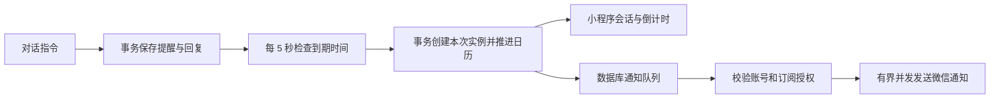

# 小禾对话提醒

## 使用方式

直接对小禾说“我一个小时后需要喝药”“每天晚上八点提醒我陪孩子写作业”。时间明确时在本次请求内保存，并返回真实保存结果和提醒卡片；缺少时间、事项或目标不明确时先追问。数字时间“每天8点”按 08:00 解释，回复显示完整时间供纠正；所有日历时间按 UTC+8 计算。

支持单次、每天、每周、每月、每年和固定间隔的日历计算。常见中文表达由确定性解析器处理，例如半小时后、明天九点半、每周一三五、每月31日、每隔两小时。不存在的月日跳过。当前不是任意自然语言的完整解析器；复杂表达需明确时间，不能把模型聊天里的承诺当成保存成功。

- 查询：“查看所有提醒”“吃药还有多久”；卡片每秒更新倒计时，基于服务器时间校准。
- 修改：“把吃药提醒改到晚上九点”。只改时间时保留原重复规则。
- 完成：“我已经吃药了”；也可点“完成本次”。重复提醒的未来安排继续生效。
- 推迟：“把吃药提醒推迟十分钟”。只移动这一回，从原定时间或当前时间中较晚者起算，后续日历规则不变。
- 暂停、恢复：“暂停吃药提醒”“恢复吃药提醒”。暂停不抹掉未来已安排的单次实例；恢复不集中补发过期提醒。
- 删除：“删除吃药提醒”；或点击对应卡片删除。停止未来调度，并取消尚未领取的通知。已进入微信网络请求的通知无法撤回。

同名提醒有多个时要求明确目标，不猜测删除对象。聊天回复中的卡片和“我的提醒”管理页显示同一份最新状态。“我先开口”和遗忘聊天记忆不会关闭明确设置的提醒。

## 后台调度

没有为每个用户启动计时器，也没有创建系统 cron 条目。数据库是任务的唯一持久化来源；后台固定数量的循环处理到期记录。

到期扫描与发送循环分离。扫描每批最多 1000 个有到期任务的账号，只处理已到期计划和推迟实例，单账号失败不终止其他账号。发送每实例最多 8 个并发，共享每 100ms 一个请求启动机会；每批有时间预算，未领取任务留在数据库供下轮处理。此速率上限是每服务实例的设置；多实例合计速率需与实际微信额度一起核定。

发送线程共享本轮队列耗尽结果，空闲时只执行一次领取检查；跳过一整批无授权或过期候选后会继续检查后续批次，不将其误判为空队列。结束领取不会取消已经开始的发送及其结果回写。

重复计划与每次实例分开保存。实例唯一键为提醒 ID、原定时间、日历版本；修改日历使旧排期失效。独立的账号写锁串行化提醒操作，不占用小禾聊天租约。请求 ID 与输入摘要提供幂等，跨设备修改需要当前 revision；所有读取和操作以登录账号为边界。

服务重启后继续读取未完成的日历。默认迟到十分钟以内处理，超过窗口记为错过；重复任务跳过更早积压，避免长时间停机后集中发送旧提醒。发送前事务占用订阅授权；发送结果不明或领取后崩溃超过一分钟时标为 uncertain，不盲目重发。数据库内去重不代表外部微信网络请求能实现严格 exactly-once。

当前每账号最多 100 条 active/paused 提醒；读取最多 200 个计划、200 个实例和最近 100 次提醒对话。历史保存在独立表中，不写入上游消息或账号表。数据库为自己的计划、实例、请求记录和账号锁分别建表；账号清理沿用小禾自有清理任务。

新增表及索引由后端启动时的 `registerCompanion → NewStore → AutoMigrate` 自动创建，无需手动执行 SQL。小禾默认启用；只有显式设置 `DEEIX_COMPANION_ENABLED=false` 才跳过该模块及其建表。迁移成功后才启动提醒任务和注册接口，迁移失败则返回启动错误。重复启动沿用已有表和数据。

## 容量与边界

本地场景覆盖 500 个账号、每人 10 条提醒，共 5000 条，500 条同一时刻到期，两个调度器同时处理。测试验证每人只有一条到期实例、其他未来计划保留、账号数据隔离。另用模拟发送器验证 500 次发送、最多 8 并发，慢请求不阻塞其他任务；模拟测试使用加速节拍，不能作为真实微信吞吐量。

在默认每秒约十次请求启动的设置下，500 条通知集中到期至少需要约 50 秒启动完全部请求，还需加上扫描、网络延迟、批次间隔和平台限流。100 条对应至少约十秒。这里是节拍计算，不是送达承诺。小程序打开时约十秒刷新提醒状态，倒计时本地每秒刷新；关闭后不能靠小程序计时器唤醒通知。

模板及订阅授权与自动跟进共享，配置见 [companion-assistant.md](companion-assistant.md)。一次性订阅只提供一次发送机会；没有配置或没有授权时仍保存应用内提醒。当前未进行生产服务器压测、真实微信送达测试或发布。

2026-10-17 本地验证：500 账号 / 5000 计划 / 500 同时到期 / 两个调度器，在 Windows SQLite、GOMAXPROCS=2、开启 Go race 检查时耗时约 12.01 秒，500 个实例无遗漏或重复。模拟发送器的 500 次任务在加速 1ms 节拍下约 0.52 秒完成，观测最大并发为 8；这仅验证并发上限和任务处理，不代表微信网络速度。提醒解析、生命周期、账号隔离、幂等、重启和发送结果不明等测试通过。小程序 199 项测试、类型检查、生产构建和生成契约一致性检查通过，后端启动接入测试及相关包 go vet 通过。

## 接口

- `GET /api/v1/companion/reminders?conversationID=`：当前账号的计划、实例、提醒对话及服务器时间。
- `POST /api/v1/companion/reminders/command`：文本指令或结构化卡片操作。必须提供 requestID，结构化操作不能混用 input；修改类操作携带提醒 ID 和 revision。

提醒对话单独持久化后按时间合并到小禾聊天，因此后台不会从同一指令再次提取出重复跟进。普通聊天提示包含当前提醒事实，并明确禁止声称未执行的创建、修改或删除已完成。
